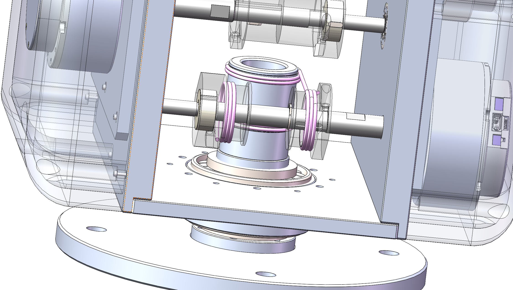

# 绳索运动学

# 六轴绳索驱动机械臂绳索运动学模型说明

> 
> 
> 
> 角度内部单位：rad
> 
> 长度参数单位：mm
> 

## 1. 文档目的

本文档定义六自由度机械臂的关节变量、减速器输出轴角度和绳索长度变化之间的运动学关系，用于：

- 实现独立的绳索运动学 C++ 模块；
- 实现 ros2_control 硬件读写中的关节角与输出轴角转换；
- 配置绳轮、导向轮和关节 2 耦合参数；
- 编写位置映射、速度映射和单元测试；
- 指导后续实机方向标定和参数校验。

本文档只讨论位置和速度运动学，不讨论：

- 绳索弹性伸长；
- 绳索松弛、摩擦和打滑；
- 绳槽叠层导致的半径变化；
- 回差、结构柔性和负载变形；
- 电流、转矩和张力控制；
- 关节极限、碰撞保护和控制器轨迹规划。

## 2. 系统组成与自由度定义

机械臂包含六个独立自由度和六个真实电机，电机 CAN ID 为 1～6。

| 独立自由度 | 关节变量 | ROS 主动关节 | 机械同步关节 | 电机 ID | 说明 |
| --- | --- | --- | --- | --- | --- |
| 1 | $S_1$ | `joint_01` | 无 | 1 | 第一自由度 |
| 2 | $S_2$ | `joint_02` | 无 | 2 | 第二自由度，同时对后续绳索回路产生长度耦合 |
| 3 | $S_3$ | `joint_03` | `joint_04 = joint_03` | 3 | `joint_03` 与 `joint_04` 由齿轮同步 |
| 4 | $S_4$ | `joint_05` | `joint_08 = -joint_05` | 4 | `joint_05` 与 `joint_08` 由连杆同步 |
| 5 | $S_5$ | `joint_06` | `joint_07 = joint_06` | 5 | `joint_06` 与 `joint_07` 由连杆同步 |
| 6 | $S_6$ | `joint_09` | 无 | 6 | 第六自由度，采用双绳路、不同半径的闭合绳索回路，末端绳索减速器 |

`joint_04`、`joint_07` 和 `joint_08` 的 mimic 关系描述机械同步，不属于绳索长度耦合。绳索长度耦合只存在于执行器输出轴角度与独立关节变量之间。

需要特别区分“等效自由度角度”和“ROS 主动关节坐标”。本文第 5 章暂按机构推导定义 $S_3=q_3+q_4$、$S_4=q_5+q_8$，并类比定义第五自由度；而 `ros2_control` 中主动关节通常直接报告 `joint_03`、`joint_05`、`joint_06` 各自的关节坐标。若这些主动关节坐标分别是 $q_3$、$q_5$、$q_6$，则它们与本文 $S_3$、$S_4$、$S_5$ 之间还存在机械同步坐标换算，不能直接视为数值相等。该边界必须在将本版公式同步到软件前确认。

独立关节向量定义为：

$$
\boldsymbol S=
\begin{bmatrix}
S_1&S_2&S_3&S_4&S_5&S_6
\end{bmatrix}^{T}
$$

减速器输出轴角度向量定义为：

$$
\boldsymbol\phi=
\begin{bmatrix}
\phi_1&\phi_2&\phi_3&\phi_4&\phi_5&\phi_6
\end{bmatrix}^{T}
$$

## 3. 建模约定

### 3.1 坐标与方向约定

1. $S_i$ 的正方向以 URDF/Xacro 中对应主动关节的 `axis` 和右手定则为准。
2. $\phi_i$ 表示第 $i$ 个减速器输出轴的角度，不是电机转子角度。
3. 每根绳路的绳长方程沿该绳路的收绳正方向书写。两根绳索在物理上一个收绳、一个放绳，但经方向归一化后可以使用相同形式的方程。
4. 关节 2 耦合项的初始符号统一按正号书写；实际安装方向通过耦合方向参数 $\sigma_i$ 标定。
5. CAN 正方向与机械输出轴正方向之间的关系由电机方向参数 $d_i$ 标定，不写入绳索几何公式。

### 3.2 零位约定

本文档采用相对于标定零位的角度增量模型：

$$
\boldsymbol S=\boldsymbol 0
\quad\Longleftrightarrow\quad
\boldsymbol\phi=\boldsymbol 0
$$

初始绝对绳长不进入运动学计算。所有绳长方程表示相对于标定零位的长度变化。

### 3.3 理想化假设

1. 绳索不可伸长。
2. 绳索与绳轮之间无滑动。
3. 绳索始终保持张紧并位于正确绳槽内。
4. 绳轮有效半径恒定，绳索不会叠层。
5. 关节 2 引起的附加绳长变化可用“关节角 × 有效半径”表示。

## 4. 符号表

### 4.1 运动变量

| 符号 | 建议代码名称 | 意义 | 单位 |
| --- | --- | --- | --- |
| $i$ | `axis_index` | 独立自由度编号 | 无量纲 |
| $S_i$ | `joint_position_rad[i]` | 第 $i$ 个等效关节变量 | rad |
| $\dot S_i$ | `joint_velocity_rad_s[i]` | 第 $i$ 个等效关节速度 | rad/s |
| $\phi_i$ | `output_position_rad[i]` | 第 $i$ 个减速器输出轴角度 | rad |
| $\dot\phi_i$ | `output_velocity_rad_s[i]` | 第 $i$ 个减速器输出轴速度 | rad/s |
| $a_i$ | `protocol_position_deg[i]` | CAN 协议使用的电机角度坐标 | deg |
| $\dot a_i$ | `protocol_velocity_deg_s[i]` | CAN 协议使用的电机速度坐标 | deg/s |

### 4.2 几何参数

| 符号 | 建议代码名称 | 意义 | 单位 |
| --- | --- | --- | --- |
| $r_i$ | `motor_radius_mm[i]` | 第 $i$ 个电机输出轴绳轮的有效半径 | mm |
| $R_i$ | `joint_radius_mm[i]` | 第 $i$ 个等效关节端的有效半径 | mm |
| $R_{i,j}$ |  | 第 $i$ 个等效关节端第$j$个真实关节的有效半径 | mm |
| $R'_{2,i}$ | `joint2_guide_radius_mm[i]` | 关节 2 对第 $i$ 个后续绳索回路产生耦合的有效半径 | mm |
| $r_{6a}$ | `axis6_branch_a_motor_radius_mm` | 第六轴小绳路的电机端有效半径 | mm |
| $R_{6a}$ | `axis6_branch_a_joint_radius_mm` | 第六轴小绳路的关节端有效半径 | mm |
| $R'_{2,6a}$ | `axis6_branch_a_joint2_radius_mm` | 第六轴小绳路在关节 2 处的有效半径 | mm |
| $r_{6b}$ | `axis6_branch_b_motor_radius_mm` | 第六轴大绳路的电机端有效半径 | mm |
| $R_{6b}$ | `axis6_branch_b_joint_radius_mm` | 第六轴大绳路的关节端有效半径 | mm |
| $R'_{2,6b}$ | `axis6_branch_b_joint2_radius_mm` | 第六轴大绳路在关节 2 处的有效半径 | mm |

所有“有效半径”均指绳索中心线到旋转轴线的距离，不一定等于滑轮金属外圆半径或绳槽底半径。

### 4.3 方向与换算参数

| 符号 | 建议代码名称 | 意义 | 允许值/单位 |
| --- | --- | --- | --- |
| $d_i$ | `motor_direction[i]` | CAN 协议正方向与输出轴正方向之间的关系 | $-1$ 或 $+1$ |
| $\sigma_i$ | `coupling_sign[i]` | 关节 2 转动对第 $i$ 条后续绳路的耦合方向 | $-1$ 或 $+1$ |
| $G_i$ | `protocol_angle_ratio[i]` | 输出轴角度到 CAN 协议角度的比例 | 无量纲，正数 |
| $C_{\mathrm{rad\to deg}}$ | `radians_to_degrees` | 弧度到角度的单位转换系数 | $180/\pi$ deg/rad |

### 4.4 派生系数

| 符号 | 定义 | 意义 | 单位 |
| --- | --- | --- | --- |
| $\alpha_i$ | $R_i/r_i$ | 线性关节自身的输出轴位置系数 | 无量纲 |
| $\alpha_{i,j}$ | $R_{i,j}/r_i$ |  |  |
| $\alpha'_{2,i}$ | $\sigma_iR'_{2,i}/r_i$ | 关节 2 对第 $i$ 个输出轴的有符号耦合系数 | 无量纲 |

### 4.5 数值参数表

有效半径为索轮半径加上绳索半径。当前按直径为 2.5 mm 的绳索进行计算，即绳索半径为 1.25 mm。若“2.5 mm”实际表示半径而不是直径，本表所有相关有效半径都必须重新计算。

| 自由度 | $r_i$/mm | $R_i$/mm | $R'_{2,i}$/mm | 自身系数 | 耦合系数幅值 $\left|\alpha'_{2,i}\right|$ | $G_i$ |
| --- | --- | --- | --- | --- | --- | --- |
| 1 | 16.25  | 19.75 | — | $\alpha_1=79/65\approx1.215385$ | $0$ | 36 |
| 2 | 16 | 16 | — | $\alpha_2=1$ | $0$ | 36 |
| 3 | 16.25 | $R_{34}=23.25$ $R_{33}=28.5$ | 28.5 | $\frac12(\alpha_{3,3}+\alpha_{3,4})=207/130\approx1.592308$ | $114/65\approx1.753846$ | 36 |
| 4 | 16.25 | 53.5 | 28.5 | $\alpha_4=214/65\approx3.292308$ | $114/65\approx1.753846$ | 6 |
| 5 | 16.25 | 53.5 | 28.5 | $\alpha_5=214/65\approx3.292308$ | $114/65\approx1.753846$ | 6 |
| 6A（小半径绳路） | 12.25 | 12.25（真值为12.15） | 20.25（理想兼容值为 $931/46\approx20.239130$） | $\alpha_{6a}=1$ | 当前值 $81/49\approx1.653061$ | 6 |
| 6B（大半径绳路） | 17.25 | 17.25（真值为17.15） | 28.5 | $\alpha_{6b}=1$ | $38/23\approx1.652174$ | 6 |

第六轴表中 6A 的当前导向有效半径 20.25 mm 与 6B 并非严格比例兼容。若以 6B 参数为基准，6A 的理想值应为：

$$
R'_{2,6a}
=
r_{6a}\frac{R'_{2,6b}}{r_{6b}}
=
\frac{931}{46}\ \mathrm{mm}
\approx20.239130\ \mathrm{mm}
$$

20.25 mm 可作为加工或测量近似值，但软件配置采用近似值时，应根据允许的几何兼容误差进行校验。

## 5. 绳长方程的符号推导

为避免电机输出轴旋转方向与关节轴旋转方向对应关系混乱，以对悬空段绳索长度的影响为基准，定义线轮拉动绳索卷起的长度为负，线轮放松释放的绳索长度为正。

本章图示方程按当前初始方向 $\sigma_i=+1$ 书写。推广到实机标定方向时，应将耦合项 $R'_{2,i}S_2$ 写为 $\sigma_iR'_{2,i}S_2$；相应方向已包含在有符号系数 $\alpha'_{2,i}$ 中。

### 5.1 关节1

#### 5.1.1 关节1的描述

如上图所示，关节 1 由水平输出轴引出绳索驱动垂直轴。

#### 5.1.2 关节1绳索运动学

对于不受关节耦合影响的线性绳轮机构，以张紧侧绳索为例，电机输出轴卷起的绳索长度与关节轴放松的绳索长度一致，即：

$$
-r_1\phi_1+R_1S_1=0
$$

定义：

$$
\alpha_i=\frac{R_i}{r_i}
$$

得到：

$$
\phi_1=\alpha_1S_1
$$

### 5.2 关节2

#### 5.2.1 关节2的描述

如上图所示，关节2使用带传动，由输出轴通过同步带驱动关节轴

#### 5.2.2 关节2绳索运动学

为方便分析，将关节2也视作绳索驱动，其驱动符合电机输出轴侧绳长变化与关节侧绳长变化相等的规律：

$$
-r_2\phi_2+R_2S_2=0
$$

得到：

$$
\phi_2=\alpha_2S_2
$$

### 5.3 关节3

#### 5.3.1 关节3的描述

关节3由绳索驱动，对应joint_3、joint_4,两个子关节之间由齿轮同步，齿轮比例为1：1。从受力角度分析，绳索经过joint_3驱动joint_4。

#### 5.3.2 关节3绳索运动学

此类关节原理如下图所示：

将三个滑轮从下到上依次标记为1、2、3，滑轮1、2转轴由连杆连接，边缘由齿轮约束，实现转角比为1：1；joint_3上过线滑轮的半径为$R_{33}$,joint_4上绳索驱动轮的有效半径为$R_{34}$，则3号滑轮为导向轮，用于确保绳索不脱离2号滑轮。

首先考虑关节端绳索长度变化与关节转角的关系，记joint_3转过的角度为$q_3$，joint_4转过的角度为$q_4$，有：

$$
q_4=q_3
$$

$$
S_3=q_3+q_4=2q_3
$$

绳索长度变化量为在滑轮上包覆长度的减少量，如左图橙色虚线与红线不重合的部分：

$$
Δl=q_3R_{33}+2q_4R_{34}-q_4R_{34}=\frac{1}{2} S_3(R_{33}+R_{34})
$$

无耦合影响的情况下，悬空段绳索长度不变

$$
-r_3\phi_3+\frac{1}{2} S_3(R_{33}+R_{34})=0
$$

但绳索通过关节2时，会受关节2转动角度$S_2$的影响，对悬空段绳索长度带来额外影响，考虑耦合时的绳索恒长公式为：

$$
-r_3\phi_3+\frac{1}{2} S_3(R_{33}+R_{34})+S_2R'_{2,3}=0
$$

得到：

$$
\phi_3=\frac{1}{2}(\alpha_{3,3}+\alpha_{3,4})S_3+\alpha'_{2,3}S_2
$$

### 5.4 关节4和5

#### 5.4.1 关节4和5的描述

关节 4、5 结构相同，均通过由凸轮矫正的连杆机构实现相对纯滚动，其几何原理见[基于平行反曲四连杆的索驱手腕设计](https://app.notion.com/p/2f8a622c674e8023b994f30a116b7d14?pvs=21)。

#### 5.4.2 关节4和5绳索运动学

关节 4 对应 `joint_05`、`joint_08`，关节 5 对应 `joint_06`、`joint_07`。下面的公式推导以关节 4 为例，等效关节变量为 $S_4$，对应机构局部转角 $q_5$、$q_8$。这里的 $q_5$、$q_8$ 按机构局部的同向转角定义；URDF 中 `joint_08 = -joint_05` 是由两个关节轴的坐标方向定义造成的，二者并不矛盾。其几何关系为：

$$

q_5=q_8
$$

$$
S_4=q_5+q_8=2q_5
$$

该关节驱动形式为非线性驱动，相对纯滚的圆直径对绳索长度变化量无影响，记绳索固定点到圆心的距离为$R_4$：

$$
Δl=R_4\sin{q_5}=R_4\sin{\frac{S_4}{2}}
$$

无耦合影响的情况下，悬空段绳索长度不变:

$$
-r_4\phi_4+R_4\sin{\frac{S_4}{2}}=0
$$

但绳索通过关节2时，会受关节2转动角度$S_2$的影响，对悬空段绳索长度带来额外影响，考虑耦合时的绳索恒长公式为：

$$
-r_4\phi_4+R_4\sin{\frac{S_4}{2}}+S_2R'_{2,4}=0
$$

得到：

$$
\phi_4=\alpha_4\sin{\frac{S_4}{2}}+\alpha'_{2,4}S_2
$$

同理，对于关节5，有

$$
\phi_5=\alpha_5\sin{\frac{S_5}{2}}+\alpha'_{2,5}S_2
$$

### 5.5 关节6

#### 5.5.1 关节6的描述

关节6在末端需要将旋转方向调整90°，因此采用绳索驱动的锥齿传动机构。可以看出两路绳索缠绕的滑轮半径并不一致，将半径小的一侧记为$R_{6a}$，半径大的一侧记为$R_{6b}$。和由此导致关节6转动时，绳索的收紧量和释放量不等，因此在驱动轮处也做了等比例设计，将绳索变化量吸收。将驱动轮的等效半径也对应记为$r_{6a}$和$r_{6b}$。

#### 5.5.2 关节6绳索运动学

无耦合影响的情况下，悬空段绳索长度不变:

$$
-r_6\phi_6+R_6S_6=0
$$

但绳索通过关节2时，会受关节2转动角度$S_2$的影响，由于绳索收缩和伸长不等，对两个绳路分别建立方程：

第六轴小绳路方程为：

$$
-r_{6a}\phi_6+
R_{6a}S_6+
R'_{2,6a}S_2=0
$$

第六轴大绳路方程为：

$$
-r_{6b}\phi_6+
R_{6b}S_6+
R'_{2,6b}S_2=0
$$

两个绳轮刚性安装在同一根输出轴上，因此当 $S_6$ 和 $S_2$ 变化时，两条绳路必须得到同一个 $\phi_6$。自身传动系数与有符号耦合系数必须分别满足：

$$
\frac{R_{6a}}{r_{6a}}
=
\frac{R_{6b}}{r_{6b}}
$$

$$
\frac{\sigma_{6a}R'_{2,6a}}{r_{6a}}
=
\frac{\sigma_{6b}R'_{2,6b}}{r_{6b}}
$$

当两条绳路的耦合方向相同，即 $\sigma_{6a}=\sigma_{6b}$ 时，上述条件也可以写成：

$$
\frac{R_{6a}}{R_{6b}}
=
\frac{r_{6a}}{r_{6b}}
=
\frac{R'_{2,6a}}{R'_{2,6b}}
$$

由此约束机械设计后，在关节位置与输出轴位置的主映射中可以不再区分 a、b。

得到：

$$
\phi_6=\alpha_6S_6+\alpha'_{2,6}S_2
$$

若以 6B 绳路的当前参数作为兼容设计基准，且 $\sigma_{6a}=\sigma_{6b}$，则统一耦合系数的幅值为：

$$
\left|\alpha'_{2,6}\right|
=
\frac{R'_{2,6b}}{r_{6b}}
=
\frac{38}{23}
\approx1.652174
$$

此时 6A 绳路的 $R'_{2,6a}$ 应采用第 4.5 节计算的理想兼容值，而不是直接使用未经容差确认的 20.25 mm。

## 6. 完整位置映射

### 6.1 关节位置到输出轴位置

使用派生系数表示完整映射：

$$
\begin{aligned}
\phi_1 &= \alpha_1S_1 \\
\phi_2 &= \alpha_2S_2 \\
\phi_3 &=\frac{1}{2}(\alpha_{3,3}+\alpha_{3,4})S_3+\alpha'_{2,3}S_2 \\
\phi_4&=\alpha_4\sin{\frac{S_4}{2}}+\alpha'_{2,4}S_2 \\
\phi_5&=\alpha_5\sin{\frac{S_5}{2}}+\alpha'_{2,5}S_2\\
\phi_6&=\alpha_6S_6+\alpha'_{2,6}S_2
\end{aligned}
$$

### 6.2 输出轴位置到关节位置

反向计算时，应先由 $\phi_2$ 求出 $S_2$，再消除后续输出轴中的关节 2 耦合项。完整反向映射为：

$$
\begin{aligned}
S_1
&=
\frac{\phi_1}{\alpha_1}
\\
S_2
&=
\frac{\phi_2}{\alpha_2}
\\
S_3
&=
\frac{2\left(\phi_3-\alpha'_{2,3}S_2\right)}
{\alpha_{3,3}+\alpha_{3,4}}
\\
S_4
&=
2\arcsin
\left(
\frac{\phi_4-\alpha'_{2,4}S_2}{\alpha_4}
\right)
\\
S_5
&=
2\arcsin
\left(
\frac{\phi_5-\alpha'_{2,5}S_2}{\alpha_5}
\right)
\\
S_6
&=
\frac{\phi_6-\alpha'_{2,6}S_2}{\alpha_6}
\end{aligned}
$$

向量形式记为：

$$
\boldsymbol S
=
\boldsymbol f_{\mathrm{cable}}^{-1}(\boldsymbol\phi)
$$

第四、第五自由度的反解默认采用 $\arcsin$ 的主值分支。若机械允许范围超出该分支的单值区间，就不能只根据当前输出轴角度唯一确定关节角度，必须增加机械范围约束或其他状态信息。当前模型应保证：

$$
-\pi < S_4 < \pi
$$

$$
-\pi < S_5 < \pi
$$

实际软件仍应以 URDF 中更严格的关节限制为准。

## 7. 完整速度映射

### 7.1 关节速度到输出轴速度

对第 6.1 节的位置映射关于时间求导，得到：

$$
\begin{aligned}
\dot\phi_1
&=
\alpha_1\dot S_1
\\
\dot\phi_2
&=
\alpha_2\dot S_2
\\
\dot\phi_3
&=
\frac{1}{2}
\left(
\alpha_{3,3}+\alpha_{3,4}
\right)
\dot S_3
+
\alpha'_{2,3}\dot S_2
\\
\dot\phi_4
&=
\frac{\alpha_4}{2}
\cos\left(\frac{S_4}{2}\right)
\dot S_4
+
\alpha'_{2,4}\dot S_2
\\
\dot\phi_5
&=
\frac{\alpha_5}{2}
\cos\left(\frac{S_5}{2}\right)
\dot S_5
+
\alpha'_{2,5}\dot S_2
\\
\dot\phi_6
&=
\alpha_6\dot S_6
+
\alpha'_{2,6}\dot S_2
\end{aligned}
$$

第四、第五自由度的输出轴速度不仅取决于关节速度，还取决于当前关节位置。因此位置与速度映射必须使用同一时刻的 $\boldsymbol S$。

### 7.2 输出轴速度到关节速度

反向速度映射同样必须先求出 $\dot S_2$，再消除后续输出轴速度中的关节 2 耦合项：

$$
\begin{aligned}
\dot S_1
&=
\frac{\dot\phi_1}{\alpha_1}
\\
\dot S_2
&=
\frac{\dot\phi_2}{\alpha_2}
\\
\dot S_3
&=
\frac{2\left(\dot\phi_3-\alpha'_{2,3}\dot S_2\right)}
{\alpha_{3,3}+\alpha_{3,4}}
\\
\dot S_4
&=
\frac{
2\left(\dot\phi_4-\alpha'_{2,4}\dot S_2\right)
}{
\alpha_4\cos\left(S_4/2\right)
}
\\
\dot S_5
&=
\frac{
2\left(\dot\phi_5-\alpha'_{2,5}\dot S_2\right)
}{
\alpha_5\cos\left(S_5/2\right)
}
\\
\dot S_6
&=
\frac{\dot\phi_6-\alpha'_{2,6}\dot S_2}{\alpha_6}
\end{aligned}
$$

计算 $\dot S_4$ 和 $\dot S_5$ 时使用的位置 $S_4$、$S_5$，应由同一批输出轴位置反馈经过第 6.2 节的位置反解得到。

### 7.3 绳索速度雅可比

定义：

$$
\dot{\boldsymbol\phi}
=
\boldsymbol J_{\mathrm{cable}}(\boldsymbol S)
\dot{\boldsymbol S}
$$

绳索速度雅可比为：

$$
\boldsymbol J_{\mathrm{cable}}(\boldsymbol S)
=
\begin{bmatrix}
\alpha_1
&0
&0
&0
&0
&0
\\
0
&\alpha_2
&0
&0
&0
&0
\\
0
&\alpha'_{2,3}
&\frac{1}{2}\left(\alpha_{3,3}+\alpha_{3,4}\right)
&0
&0
&0
\\
0
&\alpha'_{2,4}
&0
&\frac{\alpha_4}{2}\cos\left(\frac{S_4}{2}\right)
&0
&0
\\
0
&\alpha'_{2,5}
&0
&0
&\frac{\alpha_5}{2}\cos\left(\frac{S_5}{2}\right)
&0
\\
0
&\alpha'_{2,6}
&0
&0
&0
&\alpha_6
\end{bmatrix}
$$

因此：

$$
\dot{\boldsymbol S}
=
\boldsymbol J_{\mathrm{cable}}^{-1}(\boldsymbol S)
\dot{\boldsymbol\phi}
$$

雅可比行列式为：

$$
\det\boldsymbol J_{\mathrm{cable}}
=
\alpha_1\alpha_2
\frac{\alpha_{3,3}+\alpha_{3,4}}{2}
\frac{\alpha_4}{2}\cos\left(\frac{S_4}{2}\right)
\frac{\alpha_5}{2}\cos\left(\frac{S_5}{2}\right)
\alpha_6
$$

其中各项之间均为乘法关系。为了避免排版歧义，也可以写成：

$$
\det\boldsymbol J_{\mathrm{cable}}
=
\frac{
\alpha_1\alpha_2\alpha_4\alpha_5\alpha_6
\left(\alpha_{3,3}+\alpha_{3,4}\right)
}{
8
}
\cos\left(\frac{S_4}{2}\right)
\cos\left(\frac{S_5}{2}\right)
$$

当 $\cos(S_4/2)$ 或 $\cos(S_5/2)$ 接近零时，速度反解会放大测量噪声并趋于奇异。

## 8. 输出轴坐标与 CAN 协议坐标

### 8.1 位置坐标换算

绳索运动学只负责独立关节角 $\boldsymbol S$ 与减速器输出轴角 $\boldsymbol\phi$ 之间的关系。输出轴角度到 CAN 协议角度的换算独立表示为：

$$
a_i
=
d_iG_iC_{\mathrm{rad\to deg}}\phi_i
$$

其中：

$$
C_{\mathrm{rad\to deg}}
=
\frac{180}{\pi}
$$

反向换算为：

$$
\phi_i
=
\frac{d_i a_i}
{G_iC_{\mathrm{rad\to deg}}}
$$

由于 $d_i\in\{-1,+1\}$，因此 $d_i^{-1}=d_i$。

### 8.2 速度坐标换算

速度使用相同的方向和协议比例：

$$
\dot a_i
=
d_iG_iC_{\mathrm{rad\to deg}}\dot\phi_i
$$

反向换算为：

$$
\dot\phi_i
=
\frac{d_i\dot a_i}
{G_iC_{\mathrm{rad\to deg}}}
$$

### 8.3 坐标分层

三个坐标层必须分开处理：

1. ROS 独立关节坐标：$\boldsymbol S$、$\dot{\boldsymbol S}$；
2. 减速器输出轴坐标：$\boldsymbol\phi$、$\dot{\boldsymbol\phi}$；
3. CAN 协议坐标：$\boldsymbol a$、$\dot{\boldsymbol a}$。

$G_i$ 和 $d_i$ 属于执行器协议换算，不属于绳索运动学几何参数。绳轮半径、关节 2 导向有效半径和机械同步关系也不应合并进 $G_i$。

## 9. 定义域与参数合法性

### 9.1 通用参数检查

加载参数时应至少检查：

- 所有半径均为有限正数；
- $\alpha_1$、$\alpha_2$、$\alpha_4$、$\alpha_5$、$\alpha_6$ 均为有限非零数；
- $\alpha_{3,3}+\alpha_{3,4}$ 为有限非零数；
- $G_i$ 为有限正数；
- $d_i$ 和 $\sigma_i$ 只能为 $-1$ 或 $+1$；
- 所有输入位置和速度均为有限数；
- 参数文件必须包含六个自由度，且顺序与软件定义一致。

### 9.2 第四、第五自由度的位置反解定义域

第四自由度必须满足：

$$
\left|
\frac{\phi_4-\alpha'_{2,4}S_2}{\alpha_4}
\right|
\leq1
$$

第五自由度必须满足：

$$
\left|
\frac{\phi_5-\alpha'_{2,5}S_2}{\alpha_5}
\right|
\leq1
$$

考虑浮点计算误差时，可以允许极小的越界容差；若超出容差，则应报告输入状态或参数不一致，不能直接对任意值进行截断。

### 9.3 速度反解奇异性

速度反解应检查：

$$
\left|
\cos\left(\frac{S_4}{2}\right)
\right|
>
\varepsilon_{\cos}
$$

$$
\left|
\cos\left(\frac{S_5}{2}\right)
\right|
>
\varepsilon_{\cos}
$$

其中 $\varepsilon_{\cos}$ 为软件配置的奇异性阈值。低于该阈值时，应拒绝速度反解或进入受限处理，不能继续除以接近零的数。

### 9.4 第六轴双绳路兼容性

第六轴参数必须满足：

$$
\left|
\frac{R_{6a}}{r_{6a}}
-
\frac{R_{6b}}{r_{6b}}
\right|
\leq
\varepsilon_6
$$

$$
\left|
\frac{\sigma_{6a}R'_{2,6a}}{r_{6a}}
-
\frac{\sigma_{6b}R'_{2,6b}}{r_{6b}}
\right|
\leq
\varepsilon_6
$$

其中 $\varepsilon_6$ 是无量纲兼容误差阈值。

还可以分别计算两条绳路的闭合残差：

$$
\varepsilon_{6a}^{(l)}
=
-r_{6a}\phi_6
+
R_{6a}S_6
+
\sigma_{6a}R'_{2,6a}S_2
$$

$$
\varepsilon_{6b}^{(l)}
=
-r_{6b}\phi_6
+
R_{6b}S_6
+
\sigma_{6b}R'_{2,6b}S_2
$$

理想情况下：

$$
\varepsilon_{6a}^{(l)}
=
\varepsilon_{6b}^{(l)}
=
0
$$

闭合残差的单位为 mm，可用于参数检查、仿真测试和实机数据分析。

## 10. 软件实现顺序

### 10.1 关节命令写入电机

位置命令的计算顺序应为：

$$
\boldsymbol S_{\mathrm{cmd}}
\xrightarrow{\boldsymbol f_{\mathrm{cable}}}
\boldsymbol\phi_{\mathrm{cmd}}
\xrightarrow{d_i,G_i}
\boldsymbol a_{\mathrm{cmd}}
$$

速度命令的计算顺序应为：

$$
\dot{\boldsymbol S}_{\mathrm{cmd}}
\xrightarrow{\boldsymbol J_{\mathrm{cable}}(\boldsymbol S_{\mathrm{cmd}})}
\dot{\boldsymbol\phi}_{\mathrm{cmd}}
\xrightarrow{d_i,G_i}
\dot{\boldsymbol a}_{\mathrm{cmd}}
$$

六个输出轴必须作为一个完整向量计算。即使只有 $S_2$ 发生变化，也必须重新计算 $\phi_3$、$\phi_4$、$\phi_5$ 和 $\phi_6$。

### 10.2 电机反馈恢复关节状态

位置反馈的计算顺序应为：

$$
\boldsymbol a_{\mathrm{fb}}
\xrightarrow{d_i,G_i}
\boldsymbol\phi_{\mathrm{fb}}
\xrightarrow{\boldsymbol f_{\mathrm{cable}}^{-1}}
\boldsymbol S_{\mathrm{fb}}
$$

速度反馈的计算顺序应为：

$$
\dot{\boldsymbol a}_{\mathrm{fb}}
\xrightarrow{d_i,G_i}
\dot{\boldsymbol\phi}_{\mathrm{fb}}
\xrightarrow{\boldsymbol J_{\mathrm{cable}}^{-1}(\boldsymbol S_{\mathrm{fb}})}
\dot{\boldsymbol S}_{\mathrm{fb}}
$$

反解时必须先得到 $S_2$ 和 $\dot S_2$，再恢复第三至第六自由度。

### 10.3 零位与绝对编码器

本文档使用相对于标定零位的增量模型。如果 CAN 协议返回绝对编码器角度，软件应先减去对应输出轴零位偏置，再将结果作为 $\phi_i$ 输入绳索运动学：

$$
\phi_i
=
\phi_{i,\mathrm{absolute}}
-
\phi_{i,0}
$$

零位偏置属于标定参数，不改变本文的绳长几何公式。

## 11. 单元测试基准

### 11.1 参数测试

- 半径为零、负数或非有限数时拒绝加载；
- $G_i\leq0$ 时拒绝加载；
- $d_i$ 或 $\sigma_i$ 不是 $\pm1$ 时拒绝加载；
- 第六轴两条绳路比例不兼容时拒绝加载或明确报警；
- 参数缺失、自由度数量不等于六或关节顺序错误时拒绝加载。

### 11.2 位置映射测试

- $\boldsymbol S=\boldsymbol0$ 时，应得到 $\boldsymbol\phi=\boldsymbol0$；
- 分别只改变 $S_1$、$S_3$、$S_4$、$S_5$、$S_6$，检查对应自身项；
- 只改变 $S_2$，检查 $\phi_2$ 以及 $\phi_3$～$\phi_6$ 的耦合项；
- 随机生成合法的 $\boldsymbol S$，执行正向映射和反向映射，验证恢复误差；
- 对第四、第五自由度的反正弦定义域边界进行测试；
- 对超出反正弦定义域的输入验证错误处理。

### 11.3 速度映射测试

- 在多个合法位置下比较解析雅可比与位置映射的数值差分；
- 随机生成合法的 $\boldsymbol S$ 和 $\dot{\boldsymbol S}$，验证速度正解和反解；
- 只设置 $\dot S_2\neq0$，检查后续四个输出轴速度中的耦合项；
- 在 $\cos(S_4/2)$ 或 $\cos(S_5/2)$ 接近零时验证奇异性保护。

### 11.4 第六轴双绳路测试

- 使用兼容参数时，两条绳路应得到相同的 $\phi_6$；
- 使用不兼容参数时，应在初始化阶段报告错误；
- 对随机 $S_2$、$S_6$ 检查两条绳路的闭合残差；
- 分别验证正向和反向运动，不应根据运动方向切换绳轮半径。

### 11.5 CAN 坐标分层测试

- 验证输出轴角度到协议角度再反向恢复的往返误差；
- 分别测试 $d_i=+1$ 和 $d_i=-1$；
- 验证 $G_i$ 只参与协议坐标换算，不影响绳索几何正反解。

## 12. 参数确认与软件同步说明

本文档第 5 章给出的参数来自当前机械设计记录。软件已按这些参数生成 `model_version: 2` 的候选配置，但在真实机械臂验收前仍需要确认：

1. “2.5 mm 绳索”表示绳索直径还是绳索半径；
2. 表中标注的绳轮尺寸是金属半径、绳槽半径还是绳索中心线有效半径；
3. 第六轴“真值”12.15 mm、17.15 mm 与当前采用值12.25 mm、17.25 mm 的来源及使用场景；
4. 第六轴小绳路在关节 2 处最终采用理论兼容值、加工值还是实测值；
5. 四条关节 2 耦合项的实际方向 $\sigma_i$；
6. 六个 CAN 协议坐标方向 $d_i$；
7. $G_i$ 是否确实表示 CAN 协议角度与减速器输出轴角度之比。
8. 当前软件采用 $S_3=2q_3$、$S_4=2q_5$、$S_5=2q_6$，并将该关系代入公式后直接以 ROS 主动关节坐标作为库接口；实机应确认这一机械等效关系成立。

本文档中的第三、第四和第五自由度公式已经不同于此前采用的简化模型：

- 第三自由度显式包含 $R_{33}$ 和 $R_{34}$；
- 第四、第五自由度使用 $\sin(S_i/2)$；
- 相应速度系数为 $\frac{\alpha_i}{2}\cos(S_i/2)$。

当前 C++ 实现、YAML、配置加载器和单元测试已经按本版公式同步。软件形式直接使用 ROS 主动关节坐标：

$$
\begin{aligned}
\phi_3
&=
(\alpha_{3,3}+\alpha_{3,4})q_3+\alpha'_{2,3}q_2
\\
\phi_4
&=
\alpha_4\sin q_5+\alpha'_{2,4}q_2
\\
\phi_5
&=
\alpha_5\sin q_6+\alpha'_{2,5}q_2
\end{aligned}
$$

这与本文的等效角形式严格等价，调用方不得再次对 `joint_03`、`joint_05`、`joint_06` 乘以 2。尚未同步完成的是实机方向标定和有效半径实测确认；这些结果应通过 YAML 和 Xacro 中的方向参数更新，不应再次修改公式结构。

本模型的核心结论是：关节 2 引起的是执行器绳长耦合，而不是额外的关节角约束。ROS 和 MoveIt 仍然使用六个独立自由度；绳索耦合只在独立关节坐标与减速器输出轴坐标之间进行整体换算。
