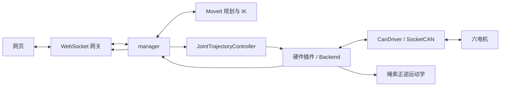

# 源码与开发约定

本工作区有 11 个 ROS 2 包，组成从运动请求、轨迹规划到 CAN 电机控制的链路。安装、整体启动和版本恢复见 [根 README](../README.md)，网页操作见 [web](../web/README.md)。

编写运动程序时，从 [manager 的动作接口](pi_arm_manager/README.md#接口与文件) 接入；软件标零及 Python 任务调用见 [pi_arm_tasks](pi_arm_tasks/README.md)。编写新的网页客户端时使用 [WebSocket 协议](pi_arm_websocket/README.md#协议)，在独立 C++ 程序中计算关节角和输出轴角时使用 [绳索库](pi_arm_transmission/README.md#程序调用)。

## 包索引

| 包 | 职责 |
| --- | --- |
| [pi_arm_bringup](pi_arm_bringup/README.md) | 装配 launch、控制器、manager 和网关配置 |
| [pi_arm_interfaces](pi_arm_interfaces/README.md) | 消息、服务和动作契约 |
| [pi_arm_tasks](pi_arm_tasks/README.md) | 软件标零与标定姿态采样任务，各自提供 Python 和命令行入口 |
| [pi_arm_manager](pi_arm_manager/README.md) | 任务准入、规划/插值、到位核验及停止协调 |
| [pi_arm_websocket](pi_arm_websocket/README.md) | JSON 协议、单位转换、点位库与坐标显示 |
| [pi_arm_hardware](pi_arm_hardware/README.md) | ros2_control 插件、实机/mock 后端、标定与写入许可 |
| [pi_arm_can](pi_arm_can/README.md) | SocketCAN、协议编码与电机反馈 |
| [pi_arm_transmission](pi_arm_transmission/README.md) | 绳索正逆运动学、速度换算与 Jacobian 的 C++ 库 |
| [pi_arm_description](pi_arm_description/README.md) | URDF/Xacro、网格、关节限位、执行器及绳索参数 |
| [pi_arm_moveit_config](pi_arm_moveit_config/README.md) | MoveIt 规划组、IK、OMPL/Pilz 与碰撞场景配置 |
| [pi_arm_output_visualizer](pi_arm_output_visualizer/README.md) | 将输出轴角转换为关节姿态，在 RViz 中显示 |

## 控制与反馈链

- Topic 持续发布状态：`/pi_arm/hardware_state` → manager → `/pi_arm/state`；`/joint_states` → robot_state_publisher → `/tf`、`/tf_static`。
- Service 处理管理操作与只读预览；Action 承载有任务编号、反馈、终态及取消的运动，定义见 [接口包](pi_arm_interfaces/README.md)。
- controller_manager 的 50 Hz 循环依次 `read → update → write`。管理请求和停止确认由硬件服务线程处理。
- 每次运动通过租约取得临时写入许可；硬件同时核对控制条件和新控制器命令。租约变更与 CAN 目标提交串行处理。CAN 接口另有进程独占锁，用于协调驱动实例对总线的占用。
- 成功到位保留最终位置目标；用户取消或点击停止时，关闭轨迹写入并保持当前编码器位置。故障、超时和服务退出使用释放位置闭环的停止路径，确认条件见 [硬件包](pi_arm_hardware/README.md#停止并保持)。
- 只读/commissioning 使用独立监测节点。离线 RViz 显示通过独立 ROS 域与控制系统并行运行。

## 坐标和数据约定

ROS 使用 rad、rad/s、m；网页常用 °、°/s、mm；协议位置使用电机协议度，单位在模块边界转换。主动关节数组顺序为 `joint_01, joint_02, joint_04, joint_05, joint_06, joint_09`；电机数组按 CAN ID 1–6 排列。腕部映射为 CAN4 → J5、CAN5 → J4。

坐标换算分为以下几步，具体参数见 [硬件配置](pi_arm_hardware/config/README.md)：

| 数据 | 含义与换算 |
| --- | --- |
| 协议角 | 电机控制器回报的角度，单位为协议度 |
| 原始输出轴角 | 协议角按减速比、安装方向换算后的输出端角度 |
| 模型输出轴角 | 原始输出轴角加软件零偏，作为绳索模型的输入 |
| 关节角 | 绳索反解得到的主动关节相对转角 |
| 连杆/末端位姿 | 由关节角和 URDF 做正运动学（FK）计算，得到位置与姿态 |

网页复用后端坐标换算，FK 与三维显示使用同一 URDF。

## 源码风格与边界

[.editorconfig](../.editorconfig) 为源码约定 UTF-8、LF、文件末尾换行和空格缩进；Python 使用 4 个空格，C++、JavaScript、HTML、CSS、Shell 和 CMake 使用 2 个空格。修改时沿用所在文件的风格，格式整理限定在实际变更范围内。

标定、动捕、第三方文件及 YAML、URDF/Xacro、测量数据保持原有格式，相关变更单独明确范围。Markdown 保留有意义的尾部双空格。

- 命名：Python 函数和变量使用 `snake_case`，类使用 `PascalCase`；C++、JavaScript 遵循所在模块的现有命名。ROS 接口、JSON 字段、配置键和 DOM 标识按接口兼容要求维护。
- 单位：跨边界或容易混淆的值在名称或类型中标明单位，如 `position_rad`、`speed_deg_s`、`timeout_ms`。协议角、输出轴角、关节角及各类编号采用上文约定。
- 错误处理：输入和配置在入口校验；运动失败、超时、取消和停止未确认沿用已有状态向上报告，并保留原因。结果未知的运动交由操作者核对后重新发起。
- 职责：网页负责交互，网关负责协议和 ROS 适配，manager 负责运动编排，硬件层负责写入许可与驱动。重复逻辑优先复用已有函数，辅助模块按实际职责拆分。

## 修改与提交约定

1. 在 `refactor/code-organization` 工作分支分批修改，相关测试通过后合入 `main`；历史恢复点使用标签，见 [备份与恢复](../README.md#备份与恢复)。提交描述说明具体行为及验证；临时输出和一次性工具存放在仓库外。
2. C++ 使用现有 C++17/ament_cmake 结构；Python 包使用 ament_python。公共接口放 `include/` 或 interfaces 包，测试放各包 `test/`，配置放 `config/`。
3. 调整 ROS 接口时同步生产者、消费者、网关与测试；调整限位/方向时同步正逆映射、速度/Jacobian、反馈判定和配置指纹，保留原始标定测量记录。
4. 调整模型优先修改源 URDF/Xacro；`web/model/` 是生成目录。更新前端功能时同步 HTML 中的资源版本参数，保持稳定 DOM 测试标识。
5. 运动成功以完成反馈到位核验为准。失败或超时后保留任务结果，供操作者检查。
6. 按变更选择相关测试，见 [脚本说明](../scripts/README.md)。mock 使用独立域/端口，vcan 使用虚拟接口，实机运动由操作者确认执行。静态文档调整检查链接、参数和差异。
7. 文档跟随功能提交更新：整体启动归根 README，用户操作归 web，各包职责/接口归包 README。历史过程通过 Git 追溯，许可证、原始协议和标定证据按原路径保留。

## 构建与诊断

完整构建使用根目录 `scripts/build.sh`。局部构建可用 `colcon build --symlink-install --packages-up-to <包名>`，接口改变后重建依赖包。C++/launch/config 更改在构建并重启后端后生效。

查看运行中的节点、话题、服务和动作可用 `ros2 node list`、`ros2 topic list`、`ros2 service list`、`ros2 action list`；接口字段可用 `ros2 interface show pi_arm_interfaces/msg/RobotState` 查看。运动程序通过 manager 的动作接口提交目标。
