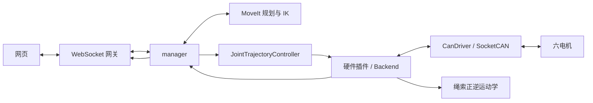

# 源码与开发约定

本工作区有 10 个 ROS 2 包。安装、整体启动和版本恢复统一见 [根 README](../README.md)，网页操作见 [web](../web/README.md)。

## 包索引

| 包 | 职责 |
| --- | --- |
| [pi_arm_bringup](pi_arm_bringup/README.md) | 装配 launch、控制器、manager 和网关配置 |
| [pi_arm_interfaces](pi_arm_interfaces/README.md) | 消息、服务和动作契约 |
| [pi_arm_manager](pi_arm_manager/README.md) | 任务准入、规划/插值、到位核验及停止协调 |
| [pi_arm_websocket](pi_arm_websocket/README.md) | JSON 协议、单位转换、点位库与坐标显示 |
| [pi_arm_hardware](pi_arm_hardware/README.md) | ros2_control 插件、实机/mock 后端、标定与写入许可 |
| [pi_arm_can](pi_arm_can/README.md) | SocketCAN、协议编码与电机反馈 |
| [pi_arm_transmission](pi_arm_transmission/README.md) | 不依赖 ROS 节点的绳索正逆运动学与 Jacobian |
| [pi_arm_description](pi_arm_description/README.md) | URDF/Xacro、网格、关节限位、执行器及绳索参数 |
| [pi_arm_moveit_config](pi_arm_moveit_config/README.md) | MoveIt 规划组、IK、OMPL/Pilz 与碰撞场景配置 |
| [pi_arm_output_visualizer](pi_arm_output_visualizer/README.md) | 输出轴角驱动的离线 RViz 可视化，不控制电机 |

## 控制与反馈链

- Topic 持续发布状态：`/pi_arm/hardware_state` → manager → `/pi_arm/state`；`/joint_states` → robot_state_publisher → `/tf`、`/tf_static`。
- Service 处理管理操作与只读预览；Action 承载有任务编号、反馈、终态及取消的运动，定义见 [接口包](pi_arm_interfaces/README.md)。
- controller_manager 的 50 Hz 循环依次 `read → update → write`。硬件服务线程处理管理请求，停止等待不应阻塞实时控制循环。
- 正常位置写入必须同时满足服务端控制许可、当前轨迹租约与新控制器命令。撤销租约与提交 CAN 目标串行化，旧命令不能在停止后重新生效。
- 成功运动保留最后位置闭环；异常/显式停止发送并确认停止。前端按钮禁用只是交互约束，不能替代后端检查。
- 只读/commissioning 使用独立监测节点，不启动正常 manager/JTC；独立 RViz 显示节点不可与实机共用 `/joint_states`。

## 坐标和数据约定

ROS 使用 rad、rad/s、m；网页常用 °、°/s、mm；协议位置使用电机协议度。转换仅在边界进行。六主动关节顺序为 `joint_01, joint_02, joint_04, joint_05, joint_06, joint_09`，不能把数组下标、CAN ID 和 URDF joint 编号混用。腕部 CAN4 → J5、CAN5 → J4。

坐标链 `协议角 → 原始输出轴角 → 标定零偏 → 模型输出轴角 → 绳索反解关节角 → URDF FK` 见 [硬件配置](pi_arm_hardware/config/README.md)。网页不得另设方向/零偏或硬编码另一份运动学；FK 与三维模型使用同一 URDF。

## 修改与提交约定

1. 在开发分支修改，`重复定位精度测试1.0` 用作恢复基线。提交描述说明具体行为及验证；临时调试输出、截图和一次性计划留在 `/tmp` 或 Git 历史，不继续堆入使用文档。
2. C++ 使用现有 C++17/ament_cmake 结构；Python 包使用 ament_python。公共接口放 `include/` 或 interfaces 包，测试放各包 `test/`，配置放 `config/`。
3. 调整 ROS 接口时同步生产者、消费者、网关与测试；调整限位/方向时同步正逆映射、速度/Jacobian、反馈判定和配置指纹。不要修改旧标定原始测量来适配新模型。
4. 调整模型优先修改源 URDF/Xacro；`web/model/` 是生成目录。修改前端控制相关脚本时同步 HTML 中的资源版本参数，保持稳定 DOM 测试标识。
5. 成功定义为后端反馈核验到位，不能把请求接受、JTC 成功或电机静止单独当作到位。失败/超时不能自动重发未知结果的运动。
6. 按变更选择相关测试，见 [脚本说明](../scripts/README.md)。mock 使用独立域/端口；vcan 只用虚拟接口；实机运动由操作者在网页确认执行。静态文档调整只需链接、参数和差异检查，不为此重启实机。
7. 文档跟随功能提交更新：整体启动归根 README，用户操作归 web，各包职责/接口归包 README。保留许可证、原始协议、可追溯标定证据与正式测试，不保留重复的“计划/过程/验收快照”作为当前说明。

## 构建与诊断

完整构建统一使用根目录 `scripts/build.sh`。局部构建可用 `colcon build --symlink-install --packages-up-to <包名>`，接口改变后需重建依赖包。C++/launch/config 更改在重启后端后才完整生效，不能仅刷新网页。

读取图与接口可用 `ros2 node list`、`ros2 topic list`、`ros2 service list`、`ros2 action list`、`ros2 interface show pi_arm_interfaces/msg/RobotState`。这些只用于诊断，不能用绕过 manager 的控制器目标替代正常实机控制链。
