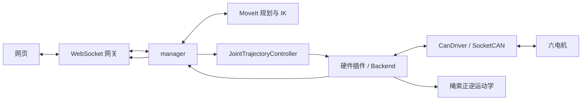

# 源码与开发约定

本工作区有 11 个 ROS 2 包。安装、整体启动和版本恢复统一见 [根 README](../README.md)，网页操作见 [web](../web/README.md)。

## 包索引

| 包 | 职责 |
| --- | --- |
| [pi_arm_bringup](pi_arm_bringup/README.md) | 装配 launch、控制器、manager 和网关配置 |
| [pi_arm_interfaces](pi_arm_interfaces/README.md) | 消息、服务和动作契约 |
| [pi_arm_tasks](pi_arm_tasks/README.md) | 可编程任务入口；软件标零流程、Python 客户端及命令行 |
| [pi_arm_manager](pi_arm_manager/README.md) | 任务准入、规划/插值、到位核验及停止协调 |
| [pi_arm_websocket](pi_arm_websocket/README.md) | JSON 协议、单位转换、点位库与坐标显示 |
| [pi_arm_hardware](pi_arm_hardware/README.md) | ros2_control 插件、实机/mock 后端、标定与写入许可 |
| [pi_arm_can](pi_arm_can/README.md) | SocketCAN、协议编码与电机反馈 |
| [pi_arm_transmission](pi_arm_transmission/README.md) | 不依赖 ROS 节点的绳索正逆运动学与 Jacobian |
| [pi_arm_description](pi_arm_description/README.md) | URDF/Xacro、网格、关节限位、执行器及绳索参数 |
| [pi_arm_moveit_config](pi_arm_moveit_config/README.md) | MoveIt 规划组、IK、OMPL/Pilz 与碰撞场景配置 |
| [pi_arm_output_visualizer](pi_arm_output_visualizer/README.md) | 输出轴角驱动的离线 RViz 可视化，不控制电机 |

## 控制与反馈链

- Topic 持续发布状态：`/pi_arm/hardware_state` → manager → `/pi_arm/state`；`/joint_states` → robot_state_publisher → `/tf`、`/tf_static`。
- Service 处理管理操作与只读预览；Action 承载有任务编号、反馈、终态及取消的运动，定义见 [接口包](pi_arm_interfaces/README.md)。
- controller_manager 的 50 Hz 循环依次 `read → update → write`。硬件服务线程处理管理请求，停止等待不应阻塞实时控制循环。
- 正常位置写入必须同时满足服务端控制许可、当前运动租约与新控制器命令。运动租约是一次任务持有的临时写入许可；撤销许可与提交 CAN 目标串行处理，避免旧目标在停止后重新生效。它与 CAN 接口的进程独占锁不同，后者防止两个驱动同时占用总线。
- 成功到位保留最终位置目标；用户取消或点击停止时，关闭轨迹写入并保持当前编码器位置。故障、超时和服务退出走释放位置闭环的停止路径，具体确认条件见 [硬件包](pi_arm_hardware/README.md#停止并保持)。前端按钮禁用不能替代后端检查。
- 只读/commissioning 使用独立监测节点，不启动正常 manager/JTC；独立 RViz 显示节点不可与实机共用 `/joint_states`。

## 坐标和数据约定

ROS 使用 rad、rad/s、m；网页常用 °、°/s、mm；协议位置使用电机协议度。转换仅在边界进行。六主动关节顺序为 `joint_01, joint_02, joint_04, joint_05, joint_06, joint_09`，不能把数组下标、CAN ID 和 URDF joint 编号混用。腕部 CAN4 → J5、CAN5 → J4。

坐标换算分为以下几步，具体参数见 [硬件配置](pi_arm_hardware/config/README.md)：

| 数据 | 含义与换算 |
| --- | --- |
| 协议角 | 电机控制器回报的角度，单位为协议度 |
| 原始输出轴角 | 协议角按减速比、安装方向换算后的输出端角度 |
| 模型输出轴角 | 原始输出轴角加软件零偏，作为绳索模型的输入 |
| 关节角 | 绳索反解得到的主动关节相对转角 |
| 连杆/末端位姿 | 由关节角和 URDF 做正运动学（FK）计算，得到位置与姿态 |

网页复用后端坐标换算；FK 与三维显示使用同一 URDF，避免各自维护一套方向、零偏或装配关系。

## 源码风格与边界

[.editorconfig](../.editorconfig) 为纳入范围的源码约定 UTF-8、LF、文件末尾换行和空格缩进；Python 使用 4 个空格，C++、JavaScript、HTML、CSS、Shell 和 CMake 使用 2 个空格。它只提供编辑器设置，不自动批量格式化。修改时沿用所在文件的风格，不夹带整文件换行或格式整理。

标定、动捕、第三方代码、生成文件及构建产物不纳入自动格式整理范围；YAML、URDF/Xacro、测量数据等保持原有格式。Markdown 保留有意义的尾部双空格。标定和动捕的修改需单独明确范围。

- 命名：Python 函数和变量使用 `snake_case`，类使用 `PascalCase`；C++、JavaScript 优先遵循所在模块的现有命名。不要仅为统一风格改动 ROS 接口、JSON 字段、配置键或 DOM 标识。
- 单位：跨边界或容易混淆的值在名称或类型中标明单位，如 `position_rad`、`speed_deg_s`、`timeout_ms`；明确区分协议角、输出轴角、关节角，以及 CAN ID、数组下标、关节编号。内部复用已经明确单位的值，不重复换算。
- 错误处理：输入和配置错误在入口明确拒绝；运动失败、超时、取消和停止未确认沿用已有状态与原因向上报告。捕获异常时保留原因，不吞掉错误后返回成功，也不自动重试结果未知的运动。
- 职责：网页负责交互，网关负责协议和 ROS 适配，manager 负责运动编排，硬件层负责写入许可与驱动。优先复用已有函数；只有重复逻辑或职责边界明确时才提取辅助模块，不引入暂无使用者的抽象。

## 修改与提交约定

1. 在 `refactor/code-organization` 工作分支分批修改，相关测试通过后合入 `main`；历史恢复点使用标签，见 [备份与恢复](../README.md#备份与恢复)。提交描述说明具体行为及验证；临时调试输出、截图和一次性计划留在 `/tmp` 或 Git 历史，不继续堆入使用文档。
2. C++ 使用现有 C++17/ament_cmake 结构；Python 包使用 ament_python。公共接口放 `include/` 或 interfaces 包，测试放各包 `test/`，配置放 `config/`。
3. 调整 ROS 接口时同步生产者、消费者、网关与测试；调整限位/方向时同步正逆映射、速度/Jacobian、反馈判定和配置指纹。不要修改旧标定原始测量来适配新模型。
4. 调整模型优先修改源 URDF/Xacro；`web/model/` 是生成目录。修改前端控制相关脚本时同步 HTML 中的资源版本参数，保持稳定 DOM 测试标识。
5. 成功定义为后端反馈核验到位，不能把请求接受、JTC 成功或电机静止单独当作到位。失败/超时不能自动重发未知结果的运动。
6. 按变更选择相关测试，见 [脚本说明](../scripts/README.md)。mock 使用独立域/端口；vcan 只用虚拟接口；实机运动由操作者在网页确认执行。静态文档调整只需链接、参数和差异检查，不为此重启实机。
7. 文档跟随功能提交更新：整体启动归根 README，用户操作归 web，各包职责/接口归包 README。保留许可证、原始协议、可追溯标定证据与正式测试，不保留重复的“计划/过程/验收快照”作为当前说明。

## 构建与诊断

完整构建统一使用根目录 `scripts/build.sh`。局部构建可用 `colcon build --symlink-install --packages-up-to <包名>`，接口改变后需重建依赖包。C++/launch/config 更改在重启后端后才完整生效，不能仅刷新网页。

读取图与接口可用 `ros2 node list`、`ros2 topic list`、`ros2 service list`、`ros2 action list`、`ros2 interface show pi_arm_interfaces/msg/RobotState`。这些只用于诊断，不能用绕过 manager 的控制器目标替代正常实机控制链。
